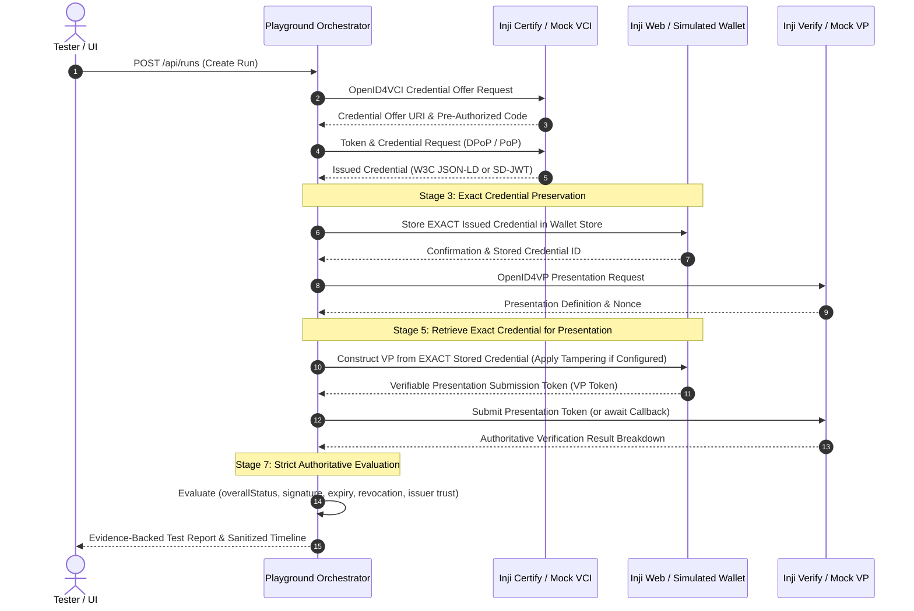

# Architecture and Integration Boundaries

> **Status**: Approved Architecture & Technical Specification  
> **Architect**: Arnav  
> **Version**: 1.1 (Repaired & Audited)  

## 1. Goal

Run real issuance → wallet holding → presentation → verification across Inji components, capturing actual protocol exchanges, errors, and the verifier's authoritative cryptographic outcome.

**Foundational Rule**: HTTP transport success, wallet redirects, and presentation receipts do **not** independently establish a verification pass. Authoritative cryptographic validation evidence is required.

---

## 2. System Shape

`Next.js 16 (React 19) Playground UI` → `Node/Express Playground Orchestration Engine (:4000)` → Documented Inji Service Interfaces.

The human uses the selected wallet and consents to credential sharing. Mimoto is included when required by the selected Inji Web setup. Inji Certify is the issuer; Inji Verify is the relying-party verifier. The engine coordinates the playground run, preserves exact credential payloads across stages, captures redacted evidence, and evaluates authoritative outcomes.

---

## 3. End-to-End Sequence & Exact Credential Data Flow

### Detailed Stage Lifecycle

1. **Discovery & Offer**: The engine queries issuer metadata and requests an OpenID4VCI credential offer for the specified credential format.
2. **Credential Delivery**: Issuer issues the signed credential token (e.g. W3C JSON-LD with Ed25519Signature2020 proof or SD-JWT VC).
3. **Wallet Holding (Exact Credential Flow)**: The wallet adapter receives the exact credential issued in Stage 2, stores it in its secure credential repository, and returns a holding confirmation.
4. **Presentation Request**: Inji Verify creates an OpenID4VP authorization request with input descriptors and a cryptographic nonce.
5. **Presentation Construction**: The wallet retrieves the stored credential matching the requested definition. If test tampering is enabled (corrupt signature, force expired), mutations are applied directly to that stored credential before submitting.
6. **Authoritative Verification**: Inji Verify or mock verifier verifies the VP signature, checks revocation and expiry, validates issuer DID trust, and produces an authoritative result breakdown.
7. **Report Evaluation**: `AuthoritativeVerdictEvaluator` scrutinizes the raw evidence and assigns `PASSED`, `FAILED`, `INCONCLUSIVE`, or `UNTESTED`.

---

## 4. Evaluator Correctness Invariants

To achieve a `PASSED` verdict, all 5 conditions must be explicitly verified:
1. `overallStatus === 'VALID'`
2. `isSignatureValid === true`
3. `isExpired === false`
4. `isRevoked === false`
5. `isIssuerTrusted === true`

If `isIssuerTrusted === false`, the verdict is strictly `FAILED` even if `overallStatus` was reported as `VALID`.
If the verifier response is unparseable or infrastructure times out, the verdict is `INCONCLUSIVE`.

---

## 5. Security & Boundary Architecture

1. **Strict CORS Allowlist**: Origin validation uses `config.corsOrigins` rather than open wildcard reflection in production.
2. **Comprehensive Sanitization**: `EventSanitizer` redacts sensitive tokens, private keys (PEM/JWK), passwords, OTPs, PINs, and personal identity attributes (`fullName`, `firstName`, `lastName`, `dob`, `national_id`, `address`) recursively with depth guards.
3. **Secure Webhook Callbacks**: Verifier callbacks are schema-validated with Zod, protected with optional Bearer/API-key authentication, correlated to the active run ID, and protected against replay attacks (409 Conflict).
4. **Configurable Externally Reachable Callback URL**: `CALLBACK_BASE_URL` allows remote verifier containers in Docker or external clusters to reach the orchestrator without hardcoded `localhost`.
5. **Timeout & Stuck-Run Prevention**: Every stage execution is wrapped in an `AbortController` timeout (`STAGE_TIMEOUT_MS`), and the overall run lifecycle is capped by `RUN_TIMEOUT_MS`.

---

## 6. Official References

- [Inji Certify Repository](https://github.com/inji/inji-certify) · [Certify Local Setup](https://docs.inji.io/inji-certify/build-and-deploy/local-setup)
- [Inji Web Local Setup](https://docs.inji.io/inji-wallet/inji-web/build-and-deploy/local-setup)
- [Inji Mobile Guide](https://docs.inji.io/inji-wallet/inji-mobile/functional-overview/end-user-guide)
- [Inji Verify Local Setup](https://docs.inji.io/inji-verify/build-and-deploy/local-setup)
- [OpenID4VP Verify Integration Guide](https://docs.inji.io/inji-verify/technical-overview/integration-guides/openid4vp-vp-verification-integration-guide)
