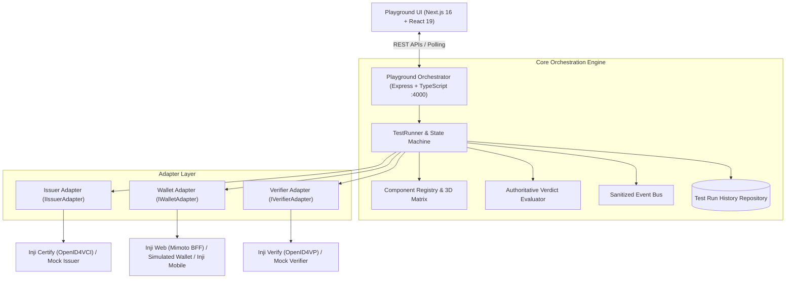

# Working Platform — Inji Interoperability Playground

> **MOSIP Decode Hackathon — Problem 02: Inji Interoperability Playground**

A test orchestration platform for exercising Verifiable Credential issuance, wallet holding, presentation, and verification across Inji modules.

The backend coordinates issuer, wallet, and verifier integrations, captures OpenID4VCI and OpenID4VP protocol events, normalizes payloads, evaluates authoritative cryptographic outcomes, and generates evidence-backed reports.

**Core Architectural Invariant**: An HTTP 200 response, wallet redirect, or presentation submission receipt alone is **never** considered a successful verification. Authoritative cryptographic validation evidence is mandatory for a `PASS` verdict.

---

## 1. Project Goal

Deliver a repeatable end-to-end interoperability test:

1. Issue a credential using Inji Certify through OpenID4VCI.
2. Store and hold that exact credential in an Inji wallet (or simulated holder).
3. Present the stored credential to Inji Verify using OpenID4VP.
4. Retrieve and cryptographically scrutinize the authoritative verification result.
5. Display diagnostics, protocol events, and a sanitized execution timeline.

The project targets two primary credential formats:
- **Format 1**: W3C VC 1.1 JSON-LD (`w3c_vc_jsonld`) — Primary baseline target
- **Format 2**: IETF SD-JWT VC (`sd_jwt_vc`) — Secondary profile target

---

## 2. Architecture



### Key Engineering Principles

1. **Authoritative Evidence vs Transport Success:** HTTP 200 confirms network transport, not credential validity. A `PASS` outcome requires:
   - Verifier `overallStatus === 'VALID'`
   - Cryptographic signature valid (`isSignatureValid === true`)
   - Unexpired credential (`isExpired === false`)
   - Revocation status clear (`isRevoked === false`)
   - Trusted issuer authority (`isIssuerTrusted === true`)
2. **Failure vs Inconclusive Taxonomy:** Network timeouts, missing callback payloads, unreachable services, and unparseable responses are strictly classified as `INCONCLUSIVE` (infrastructure/environmental), never conflated with authoritative credential rejection (`FAILED`).
3. **Exact Credential Data Flow:** The wallet adapter receives the exact credential issued in Stage 2, persists it, and constructs presentations directly from that stored credential. Mock tampering (corrupted signatures, forced expiration) is applied directly to the stored credential.
4. **Automated Sanitization:** The event bus recursively masks Bearer tokens, private keys (PEM/JWK), client assertions, OTPs, PINs, passwords, and sensitive identity attributes (`fullName`, `dob`, `national_id`, `address`) before storing or returning events.
5. **No Fabricated Evidence:** Credential types, verification outcomes, and HTTP statuses are derived strictly from observed protocol data. Missing statuses remain undefined; unobserved types are never defaulted.

---

## 3. Technology Stack

### Backend
- **Runtime**: Node.js 22.x / 24.x
- **Framework**: Express.js 4.21 (ESM)
- **Language**: TypeScript 5.7
- **Validation**: Zod 3.23 (runtime schema enforcement)
- **Testing**: Node.js Native Test Runner with `tsx` ESM loader

### Frontend
- **Framework**: Next.js 16.4 (Turbopack, App Router)
- **Library**: React 19
- **Icons**: Lucide React
- **Styles**: Modern CSS design system with HSL tokens, dark mode, and micro-animations

### Protocols & Standards
- **Issuance**: OpenID4VCI (Draft 13)
- **Presentation**: OpenID4VP (Draft 21)
- **Data Models**: W3C Verifiable Credentials 1.1 / 2.0 (JSON-LD), IETF SD-JWT VC

---

## 4. Repository Structure

```
working-platform/
├── app/                        # Next.js 16 Frontend App Router
│   ├── globals.css             # Design system tokens and styles
│   ├── layout.tsx              # Root HTML layout and metadata
│   └── page.tsx                # Playground interactive dashboard
├── lib/
│   └── playground-api.ts       # Typed API client for playground backend
├── src/                        # Backend Orchestrator Source Code
│   ├── index.ts                # Server entry point (:4000)
│   ├── app.ts                  # Express application factory with CORS
│   ├── config/env.ts           # Zod-validated environment configuration
│   ├── types/                  # Domain models, adapter interfaces, API schemas
│   ├── engine/                 # State machine, test runner, evaluator, event bus
│   ├── registry/               # Component registry & 3D compatibility matrix
│   ├── adapters/               # Inji Certify, Inji Web, Inji Verify, and Mock adapters
│   ├── routes/                 # Dual API routes: /api/runs and /api/v1/runs
│   └── storage/                # File-backed & in-memory test run repositories
├── tests/                      # Automated Test Suite (83 test cases)
│   ├── orchestrator.test.ts    # Core state machine and lifecycle tests
│   ├── wallet-data-flow.test.ts# Exact credential storage & presentation flow tests
│   └── integration/            # API, Evaluator, Sanitization, and Callback tests
├── docker-compose.yml          # Multi-container deployment configuration
├── Dockerfile.backend          # Multi-stage production Dockerfile for backend
├── Dockerfile.frontend         # Multi-stage production Dockerfile for Next.js
└── package.json                # Project dependencies and npm scripts
```

---

## 5. Quick Start

### Prerequisites
- Node.js 22.x or 24.x
- npm 10+
- Docker & Docker Compose (optional, for containerized stack)

### 1. Installation
Run from the repository root:
```bash
npm ci
```

### 2. Environment Configuration
Copy the example environment file:
```bash
cp .env.example .env
```

Key environment variables:
```env
PORT=4000
NODE_ENV=development
CORS_ORIGIN=http://localhost:3000,http://localhost:5173
CALLBACK_BASE_URL=http://localhost:4000
INJI_CERTIFY_BASE_URL=http://localhost:8080/certify
MIMOTO_WALLET_BASE_URL=http://localhost:8081/mimoto
INJI_VERIFY_BASE_URL=http://localhost:8082/verify
STAGE_TIMEOUT_MS=30000
RUN_TIMEOUT_MS=120000
NEXT_PUBLIC_PLAYGROUND_API_URL=http://localhost:4000
```

### 3. Build Both Backend and Frontend
```bash
npm run build:backend   # Compiles Express server (tsc -p tsconfig.server.json)
npm run build           # Compiles Next.js frontend with strict TypeScript enforcement
```

### 4. Run the Full Automated Test Suite
```bash
npm test
```
Executes all 83 unit and integration tests across orchestrator lifecycle, wallet data flow, verifier callbacks, sanitization policies, and evaluator branches.

### 5. Start the Services Locally
In terminal 1 (Backend Orchestrator on `:4000`):
```bash
npm run dev:backend
```

In terminal 2 (Next.js Frontend on `:3000`):
```bash
npm run dev
```
Open [http://localhost:3000](http://localhost:3000) in your browser.

---

## 6. Docker Deployment

Launch the full stack using Docker Compose:
```bash
docker compose up --build
```

Services started:
- `inji-playground-backend` on port `4000` (Node 22 multi-stage production runner)
- `inji-playground-frontend` on port `3000` (Next.js production container)
- `mock-esignet` on port `8088` (Identity provider stub for local Inji Certify)
- `postgres` on port `5432` (Shared database for Inji services)
- `inji-certify` on port `8080` (MOSIP OpenID4VCI Issuer)
- `mimoto-wallet` on port `8081` (Inji Web Wallet BFF)
- `inji-verify` on port `8082` (MOSIP OpenID4VP Verifier)

---

## 7. Mock vs Real Inji Operation

### Mock Stack (Automated Baseline)
- **Issuer**: `mock-issuer` (`mock-openid4vci`)
- **Wallet**: `simulated-wallet`
- **Verifier**: `mock-verifier` (`mock-openid4vp`)
- **Characteristics**: Instant zero-touch execution, realistic W3C VC JSON-LD and SD-JWT VC signatures, reproducible test tampering (corrupted proof, expired tokens).

### Real Inji Stack
- **Issuer**: `inji-certify` (`mosipid/inji-certify:0.10.0`)
- **Wallet**: `inji-web` (`mosipid/mimoto:0.10.0`) or `inji-mobile`
- **Verifier**: `inji-verify` (`mosipid/inji-verify:0.10.0`)
- **Requirements**: Requires eSignet/Keycloak OAuth identity provider and PostgreSQL datastore. If live services are unreachable, the orchestrator reports `INCONCLUSIVE` (e.g. `ISSUER_OFFLINE`) rather than fabricating a verdict.

---

## 8. Verification Outcomes and Semantics

| Verdict | Meaning | Mandatory Conditions |
|---|---|---|
| `PASSED` | Authoritative verification succeeded | `overallStatus === 'VALID'` AND `isSignatureValid === true` AND `isExpired === false` AND `isRevoked === false` AND `isIssuerTrusted === true` |
| `FAILED` | Authoritative credential rejection | Verifier cryptographically rejected signature, expired date, revoked status, or untrusted issuer |
| `INCONCLUSIVE` | Technical inability to determine result | Network timeout, service offline, missing callback payload, or unparseable verifier response |
| `UNTESTED` | Stage not reached | Flow aborted prior to verifier stage |

---

## 9. Known Limitations and Status

1. **Live Inji Stack Verification**: The playground includes production-ready adapters for Inji Certify, Inji Web (Mimoto), and Inji Verify v0.10.0. In environments without deployed MOSIP identity infrastructure, live endpoints yield `INCONCLUSIVE` network timeouts. Compatibility status is marked `PENDING_INTEGRATION` / `NOT VERIFIED`.
2. **mDoc / ISO 18013-5 Support**: Inji Verify v0.10.0 does not support `mso_mdoc`. Documented as an architectural blocker (`UNSUPPORTED`).
3. **Mobile Wallet (Inji Mobile)**: Marked as `EXPERIMENTAL` / interactive handoff. Automated test suites use `simulated-wallet`.
