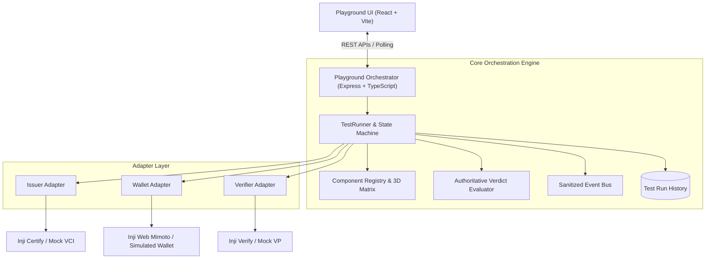

# Working Platform — Inji Interoperability Playground

> **MOSIP Decode Hackathon — Problem 02: Inji Interoperability Playground**

A test orchestration platform for exercising Verifiable Credential issuance, wallet holding, presentation, and verification across Inji modules.

The backend coordinates issuer, wallet, and verifier integrations, captures OpenID4VCI and OpenID4VP protocol events, normalizes payloads, evaluates authoritative cryptographic outcomes, and generates evidence-backed reports.

An HTTP 200 response or successful wallet redirect alone is never considered a successful verification.

---

## 1. Project Goal

Deliver a repeatable end-to-end interoperability test:

1. Issue a credential using Inji Certify through OpenID4VCI.
2. Store and hold the credential in an Inji wallet.
3. Present the credential to Inji Verify using OpenID4VP.
4. Retrieve the authoritative verification result.
5. Display diagnostics, protocol events, and a sanitized execution timeline.

The project targets at least two credential formats. The first planned format is W3C VC 1.1 JSON-LD, subject to compatibility checks with the selected issuer, wallet, and verifier versions.

---

## 2. Architecture



### Key Engineering Principles

1. **Authoritative Evidence vs Transport Success:** HTTP 200 confirms network delivery, not successful verification. A PASS outcome requires authoritative cryptographic validation evidence.

2. **Failure vs Inconclusive Taxonomy:** Network timeouts, missing callback payloads, and unconfigured endpoints must not be incorrectly classified as interoperability failures.

3. **Automated Sanitization:** The event pipeline masks Bearer tokens, private keys, client assertions, and sensitive identity attributes before storing or displaying protocol events.

4. **Clean Adapter Abstraction:** New issuers, wallets, and verifiers can be integrated through `IIssuerAdapter`, `IWalletAdapter`, and `IVerifierAdapter`.

5. **Real Wallet Consent:** The orchestration engine must not fabricate issuer/verifier responses or bypass user consent in the wallet flow.

---

## 3. Team and Responsibilities

| Team Member | Responsibility |
|---|---|
| Anav | Architecture, technical decisions, protocol design, acceptance criteria, and integration review |
| Dhyan | Backend orchestration engine, Express APIs, run lifecycle, service adapters, event capture, and verification results |
| Namya | React/TypeScript frontend, selectors, run controls, protocol timeline, and result display |
| Manay | Integration testing, setup documentation, compatibility matrix, and quality assurance |

### Collaboration Guidelines

- Work on separate branches.
- Open pull requests before merging into `main`.
- Coordinate before changing shared API contracts.
- Keep the main branch runnable.
- Document integration decisions and known limitations.

---

## 4. Technology Stack

### Backend
- Node.js 20+
- TypeScript
- Express.js
- REST APIs
- npm

### Frontend
- React
- TypeScript
- Vite

### Interoperability Standards
- OpenID4VCI — Credential Issuance
- OpenID4VP — Verifiable Presentation
- W3C Verifiable Credentials

### Inji Components
- Inji Certify — Issuer
- Inji Web / Mimoto — Wallet
- Inji Verify — Verifier

---

## 5. Backend API

The backend exposes APIs for the Playground Web Application. These are playground-owned APIs, not Inji's internal endpoints.

### Component Registry

| Method | Endpoint | Purpose |
|---|---|---|
| GET | `/api/v1/registry/components` | Retrieve registered issuers, wallets, verifiers, and credential formats |
| GET | `/api/v1/registry/matrix` | Retrieve compatibility information for component combinations |

Compatibility statuses:

- `SUPPORTED`
- `PENDING_INTEGRATION`
- `UNSUPPORTED`

### Test Runs

| Method | Endpoint | Purpose |
|---|---|---|
| POST | `/api/v1/runs` | Launch an interoperability test |
| GET | `/api/v1/runs` | Retrieve historical test runs |
| GET | `/api/v1/runs/:id` | Retrieve test run details and verification report |
| GET | `/api/v1/runs/:id/events` | Retrieve sanitized protocol events |

Example request:

```bash
curl -X POST http://localhost:4000/api/v1/runs \
  -H "Content-Type: application/json" \
  -d '{
    "issuerId": "mock-openid4vci",
    "walletId": "simulated-wallet",
    "verifierId": "mock-openid4vp",
    "format": "w3c_vc_jsonld"
  }'
```

### Verifier Webhooks

| Method | Endpoint | Purpose |
|---|---|---|
| POST | `/api/v1/callbacks/verifier/:runId` | Receive verification completion results |

### Planned Integration Contract

The broader team integration plan also defines these proposed routes:

- `POST /api/runs`
- `GET /api/runs/:runId`
- `POST /api/runs/:runId/issuance/start`
- `POST /api/runs/:runId/presentation/start`

These routes represent the planned integration contract and should be aligned with the implemented API before frontend integration.

### Event Data

Each protocol event should capture:

- Run ID
- Timestamp
- Protocol step
- Actor and direction
- Endpoint or operation
- Sanitized request/response
- HTTP status
- Error details

Sensitive tokens, OTPs, private keys, and personal credential data must be redacted.

---

## 6. Verification Outcomes

The system distinguishes transport-level success from actual credential verification.

Suggested normalized outcomes:

| Status | Meaning |
|---|---|
| PASS | Authoritative verification succeeded |
| INVALID | Credential or presentation was rejected |
| EXPIRED | Credential or request has expired |
| PENDING | Verification is still processing |
| ERROR | Technical or integration error |
| INCONCLUSIVE | Insufficient evidence to determine the outcome |

A successful HTTP request, wallet redirect, VP receipt, or transaction ID is not sufficient to declare PASS.

The backend must retrieve and evaluate the matching authoritative verifier result.

---

## 7. Quick Start

### Prerequisites

- Node.js 20+ (Node.js 22 or 24 recommended)
- npm 10+
- Git

### Installation

```bash
# Navigate to the backend directory
cd inji-interop-backend

# Install dependencies
npm install

# Build TypeScript
npm run build
```

### Run Automated Tests

```bash
npm test
```

The existing test suite covers five areas:

1. Component registry.
2. Token sanitization.
3. Successful baseline end-to-end flow.
4. Corrupted signature failure.
5. Unreachable service inconclusive handling.

### Start the Server

Development mode:

```bash
npm run dev
```

Production mode:

```bash
npm start
```

The default server port is `4000`.

---

## 8. Environment Configuration

Create your environment file using:

```bash
cp .env.example .env
```

Example configuration:

```env
PORT=4000
NODE_ENV=development
CORS_ORIGIN=http://localhost:5173,http://localhost:3000

# Inji services
INJI_CERTIFY_BASE_URL=http://localhost:8080/certify
MIMOTO_WALLET_BASE_URL=http://localhost:8081/mimoto
INJI_VERIFY_BASE_URL=http://localhost:8082/verify

# Timeouts
STAGE_TIMEOUT_MS=30000
RUN_TIMEOUT_MS=120000
```

Update service URLs according to the actual deployed Inji versions and their documented configurations.

Never commit `.env` files or credentials to GitHub.

---

## 9. Integration Plan

### Four-Day Development Plan

| Day | Objective |
|---|---|
| Day 1 | Confirm access, versions, environment, credential format, and API contracts |
| Day 2 | Connect backend orchestration and frontend; capture sanitized protocol events |
| Day 3 | Complete OpenID4VP integration and retrieve authoritative verification results |
| Day 4 | Attempt second credential format, finalize compatibility report, and rehearse demo |

### Integration Guidelines

- Pin the exact issuer, wallet, and verifier versions.
- Use official API documentation and OpenAPI specifications.
- Confirm authentication, request formats, response fields, and service URLs.
- Validate credential issuance before implementing the complete flow.
- Confirm the exact Inji Verify result-retrieval API before implementing its adapter.
- Add a second credential format only after the first complete flow works.
- Record compatibility blockers instead of claiming untested support.

---

## 10. Definition of Done

The project is considered complete when:

- A repeatable issue → hold → present → verify flow works with the selected real Inji components.
- The system records module versions and credential formats.
- Protocol exchanges and errors are captured with sensitive information redacted.
- The authoritative verifier response is available in the test report.
- PASS, INVALID, EXPIRED, PENDING, and ERROR are distinguished appropriately.
- A second credential format is tested or its compatibility blocker is documented.
- Another teammate can reproduce the setup and demo using the documentation.

---

## 11. Official References

### Inji Projects

- [Inji Certify Repository](https://github.com/inji/inji-certify)
- [Inji Certify Local Setup](https://docs.inji.io/inji-certify/build-and-deploy/local-setup)
- [Inji Web Repository](https://github.com/inji/inji-web)
- [Inji Web Local Setup](https://docs.inji.io/inji-wallet/inji-web/build-and-deploy/local-setup)
- [Inji Mobile Wallet Guide](https://docs.inji.io/inji-wallet/inji-mobile/functional-overview/end-user-guide)
- [Inji Verify Repository](https://github.com/inji/inji-verify)
- [Inji Verify Local Setup](https://docs.inji.io/inji-verify/build-and-deploy/local-setup)
- [OpenID4VP Integration Guide](https://docs.inji.io/inji-verify/technical-overview/integration-guides/openid4vp-vp-verification-integration-guide)

---

## 12. Project Status

**Current focus:** Backend orchestration engine and API integration for the Inji Interoperability Playground.

The immediate objective is to establish a reliable end-to-end interoperability flow with authoritative verification evidence, followed by additional credential formats and broader component compatibility testing.
