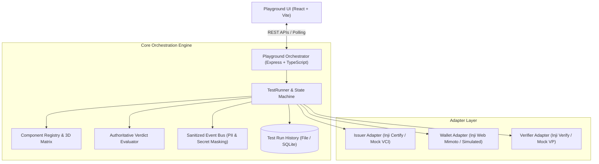

# Inji Interoperability Playground - Backend Orchestration Engine

> **MOSIP Decode Hackathon - Problem 02: Inji Interoperability Playground**  
> Test orchestration engine that coordinates issuer, wallet, and verifier integrations, captures OpenID4VCI and OpenID4VP protocol events, normalizes payloads, evaluates authoritative cryptographic outcomes, and generates evidence-backed reports.

---

## 🏗️ Architecture



### Key Engineering Principles
1. **Authoritative Evidence vs Transport Success**: An HTTP `200 OK` on submission only confirms network delivery. The engine strictly requires cryptographic validation evidence (`isSignatureValid`, trust store check, revocation check) before declaring a `PASSED` outcome.
2. **Failure vs Inconclusive Taxonomy**: Network timeouts, missing callback payloads, or unconfigured endpoints yield `INCONCLUSIVE`, preventing false negatives on the interoperability matrix.
3. **Automated Sanitization**: The event pipeline automatically masks `Bearer` tokens, private keys, client assertions, and sensitive identity attributes before writing to the protocol inspector stream.
4. **Clean Adapter Abstraction**: New issuers, wallets, or verifiers can be plugged in by implementing `IIssuerAdapter`, `IWalletAdapter`, or `IVerifierAdapter`.

---

## 🚀 Quick Start

### 1. Prerequisites
- Node.js 20+ (v22 or v24 recommended)
- npm 10+

### 2. Setup & Installation
```bash
# Navigate to directory
cd inji-interop-backend

# Install dependencies
npm install

# Build TypeScript
npm run build
```

### 3. Run Automated Interop Tests
```bash
npm test
```
Runs 5 automated suites verifying component registry, token sanitization, baseline E2E pass, corrupted signature failure, and unreachable service inconclusive handling.

### 4. Start the Server
```bash
# Development mode with hot-reloading
npm run dev

# Or production build
npm start
```
Default server port is `http://localhost:4000`.

---

## 📡 Playground Application API Contract

These endpoints are for the Playground Web Application (React UI), separated from Inji's internal APIs.

### 1. Component Registry & Matrix
- **`GET /api/v1/registry/components`**: Returns list of registered issuers, wallets, verifiers, and credential formats.
- **`GET /api/v1/registry/matrix`**: Returns compatibility status for all 3-way combinations (`SUPPORTED`, `PENDING_INTEGRATION`, `UNSUPPORTED`).

### 2. Test Runs
- **`POST /api/v1/runs`**: Launch an interoperability test run.
  ```bash
  curl -X POST http://localhost:4000/api/v1/runs \
    -H "Content-Type: application/json" \
    -d '{
      "issuerId": "mock-openid4vci",
      "walletId": "simulated-wallet",
      "verifierId": "mock-openid4vp",
      "format": "w3c_vc_jsonld"
    }'
  ```
- **`GET /api/v1/runs`**: Retrieve historical test runs.
- **`GET /api/v1/runs/:id`**: Poll current test run stage, QR code payloads, and authoritative verification report.
- **`GET /api/v1/runs/:id/events`**: Protocol inspector stream showing raw exchanged payloads (OpenID4VCI / OpenID4VP) with PII redacted.

### 3. Verifier Webhooks
- **`POST /api/v1/callbacks/verifier/:runId`**: Callback endpoint for Inji Verify or external verifiers to post verification completion results.

---

## ⚙️ Environment Configuration

Copy `.env.example` to `.env`:
```env
PORT=4000
NODE_ENV=development
CORS_ORIGIN=http://localhost:5173,http://localhost:3000

# Live Inji Services (Configured when pairing with Person 1)
INJI_CERTIFY_BASE_URL=http://localhost:8080/certify
MIMOTO_WALLET_BASE_URL=http://localhost:8081/mimoto
INJI_VERIFY_BASE_URL=http://localhost:8082/verify

# Timeouts
STAGE_TIMEOUT_MS=30000
RUN_TIMEOUT_MS=120000
```

---

## 👥 Team Collaboration Guide

- **For Person 2 (Frontend)**:
  Import [`src/types/api.ts`](./src/types/api.ts) directly into the React codebase for complete type-safety. You can test the 3-column UI right away using `mock-openid4vci`, `simulated-wallet`, and `mock-openid4vp`.
- **For Person 1 (Inji Integration)**:
  Once Inji Certify and Inji Verify are deployed (via Docker Compose or MOSIP Collab Sandbox), update the base URLs in `.env`. The adapters in `src/adapters/` will route requests directly to your real services.
